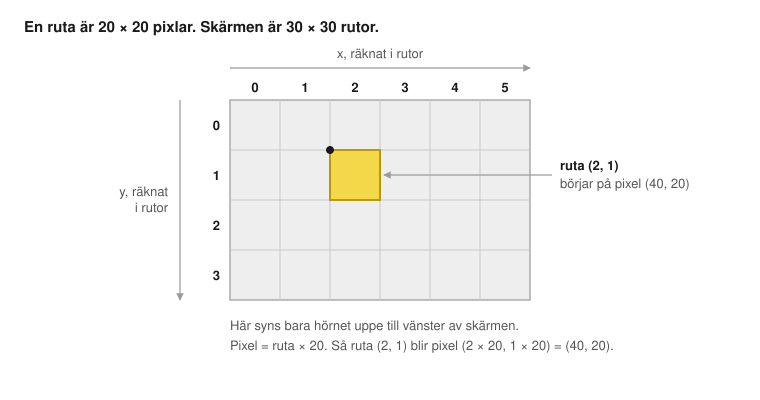
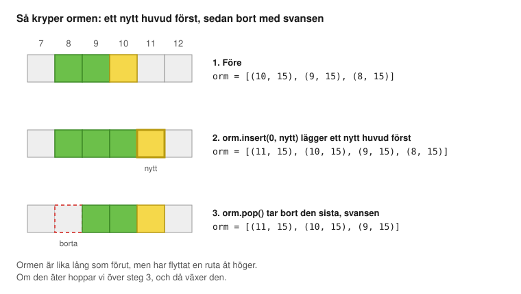

# Ormen – bygg Snake i Python

## Så här funkar guiden

Du ska göra Snake. Du styr en orm som kryper runt på skärmen och äter röda äpplen. Varje gång den äter blir den en bit längre. Krockar den med väggen eller med sig själv är det game over.

Den här guiden kommer efter [Rymdskjutaren](../rymdskjutaren/). Där lärde du dig `draw()`, listor, `for`-loopar, `if` och `global`. Det använder vi igen. Dessutom lär du dig tre nya saker:

- **Rutor.** Ormen hoppar en ruta åt gången i stället för att glida fram pixel för pixel.
- **Par.** Två tal som hör ihop, som `(10, 15)`.
- **Funktioner som tar emot och svarar.** Du skickar in saker till en funktion, och den skickar tillbaka ett svar.

Kom ihåg från förra gången:

- **Stavningen måste vara exakt rätt.** Stora och små bokstäver spelar roll.
- **Indrag visar vad som hör ihop.** Fyra mellanslag, eller ett tryck på Tab.
- **Läs sista raden i felmeddelandet.** Den säger oftast vad som är fel och på vilken rad.

Guiden har sju steg. Kör spelet efter varje steg. Skriv koden själv i stället för att kopiera, då lär du dig mer. Det är helt okej att det blir fel.

Kör du fast finns färdig kod för varje steg i mappen [`kod`](kod/).

## Steg 0: Gör i ordning datorn

Det här steget är för en vuxen.

Om datorn inte redan är fixad för Rymdskjutaren: gör först delen **Installera på Mac** eller **Installera på Windows** i [Rymdskjutarens steg 0](../rymdskjutaren/README.md#steg-0-gör-i-ordning-datorn).

Sedan behövs ett nytt projekt:

1. Skapa en mapp som heter `ormspel` och öppna den i VS Code (File → Open Folder).
2. Öppna terminalen i VS Code (Terminal → New Terminal) och skapa en Python-miljö med Pygame Zero:

   Mac:

   ```
   python3.13 -m venv .venv
   .venv/bin/python -m pip install pgzero
   ```

   Windows:

   ```
   py -3.13 -m venv .venv
   .venv\Scripts\python -m pip install pgzero
   ```

3. Tryck Cmd+Shift+P (Mac) eller Ctrl+Shift+P (Windows), skriv **Python: Select Interpreter** och välj den som pekar på `.venv`.
4. Skapa en ny fil som heter `spel.py`. All kod skriver du i den filen.

Du kör spelet med play-knappen ▶ uppe till höger.

## Steg 1: Rutor

Skriv det här i `spel.py`:

```python
import pgzrun
from pgzero.builtins import *

WIDTH = 600
HEIGHT = 600
RUTA = 20


def rita_ruta(x, y, farg):
    screen.draw.filled_rect(Rect(x * RUTA, y * RUTA, RUTA - 1, RUTA - 1), farg)


def draw():
    screen.fill("black")
    rita_ruta(0, 0, "white")
    rita_ruta(10, 15, "lime")
    rita_ruta(29, 29, "red")


pgzrun.go()
```

**Kör!** Tre små rutor ska synas: en vit uppe till vänster, en grön till vänster om mitten och en röd nere till höger.

**Vad hände?** I Rymdskjutaren räknade vi i pixlar. I Snake räknar vi i **rutor**. En ruta är 20 pixlar bred och 20 pixlar hög. Skärmen är 600 pixlar, så den rymmer 30 rutor åt varje håll. Rutorna numreras från 0, så den sista är nummer 29.



| Kod | Vad den gör |
| --- | --- |
| `from pgzero.builtins import *` | Samma som i Rymdskjutaren: berättar för VS Code vilka verktyg Pygame Zero har, så att du får förslag medan du skriver. |
| `RUTA = 20` | Hur stor en ruta är, i pixlar. |
| `def rita_ruta(x, y, farg):` | En egen funktion som ritar en ruta. `x`, `y` och `farg` kallas **parametrar**. De är tomma lappar som fylls i när någon kör funktionen. |
| `x * RUTA` | `*` betyder gånger. Ruta 10 börjar alltså på pixel 200. |
| `RUTA - 1` | Rutan ritas 19 pixlar stor i stället för 20. Då blir det en svart springa mellan rutorna, så att man ser varje bit av ormen sen. |
| `rita_ruta(10, 15, "lime")` | Kör funktionen. Lapparna fylls i: `x` blir 10, `y` blir 15 och `farg` blir `"lime"`. |

`ny_fiende()` i Rymdskjutaren gjorde exakt samma sak varje gång. `rita_ruta` gör olika saker beroende på vad du skickar in. Tre rader ger tre olika rutor, men du behövde bara skriva funktionen en gång.

**Testa själv:** rita en egen figur med fem rutor, till exempel ett plus-tecken.

**Testa:** byt `RUTA = 20` mot `RUTA = 40`. Vart tog den gröna och den röda rutan vägen?

Färdig kod: [`kod/steg1.py`](kod/steg1.py)

## Steg 2: Ormen är en lista

Lägg till ormen under `RUTA = 20`:

```python
orm = [(10, 15), (9, 15), (8, 15)]
```

Byt ut hela `draw()` mot det här:

```python
def draw():
    screen.fill("black")
    for bit in orm:
        rita_ruta(bit[0], bit[1], "lime")
    huvud = orm[0]
    rita_ruta(huvud[0], huvud[1], "yellow")
```

**Kör!** En grön orm med gult huvud ska ligga lite till vänster om mitten.

**Vad hände?** Ormen är en lista. Varje bit i listan är ett **par** tal. `(10, 15)` betyder ruta x = 10 och y = 15. Den första biten i listan är huvudet.

| Kod | Vad den gör |
| --- | --- |
| `(10, 15)` | Ett par: två tal som hör ihop, här x och y för en ruta. På Python-språk heter det en *tuple*. |
| `orm = [(10, 15), (9, 15), (8, 15)]` | En lista med tre par. Huvudet ligger på x = 10, och de två andra bitarna ligger till vänster om det. |
| `for bit in orm:` | Går igenom ormen, en bit i taget. |
| `bit[0]` | Det första talet i paret, alltså x. |
| `bit[1]` | Det andra talet i paret, alltså y. |
| `orm[0]` | Den första biten i listan, alltså huvudet. |

**Se upp!** Datorn börjar räkna på **0**. Den första saken är nummer 0, den andra är nummer 1. Det är lätt att glömma, så det är bra att lägga det på minnet redan nu.

Huvudet ritas sist, så det hamnar ovanpå den gröna biten under.

**Testa själv:** lägg till fler bitar i listan, till exempel `(7, 15), (6, 15)`. Kan du göra ormen böjd?

Färdig kod: [`kod/steg2.py`](kod/steg2.py)

## Steg 3: Ormen kryper

Lägg till en riktning under `orm = ...`:

```python
riktning = (1, 0)
```

Lägg till en ny funktion och en klocka. Skriv det precis **ovanför** `pgzrun.go()`:

```python
def steg():
    huvud = orm[0]
    nytt = (huvud[0] + riktning[0], huvud[1] + riktning[1])
    orm.insert(0, nytt)
    orm.pop()


clock.schedule_interval(steg, 0.15)
```

**Kör!** Ormen kryper åt höger... och försvinner ut ur skärmen. Lugn, det fixar vi snart.

**Vad hände?** Det här är själva knepet i Snake. Vi flyttar inte varje bit av ormen. I stället lägger vi till ett nytt huvud längst fram och tar bort svansen längst bak. Bitarna i mitten står kvar där de är, men det ser ut som att hela ormen kryper.



| Kod | Vad den gör |
| --- | --- |
| `riktning = (1, 0)` | Hur långt huvudet ska flytta varje steg: 1 ruta åt höger och 0 rutor upp eller ner. |
| `def steg():` | Flyttar ormen en ruta. |
| `nytt = (huvud[0] + riktning[0], huvud[1] + riktning[1])` | Räknar ut rutan framför huvudet: huvudets x plus riktningens x, och huvudets y plus riktningens y. |
| `orm.insert(0, nytt)` | Stoppar in det nya huvudet på plats 0, alltså först i listan. Insert är engelska och betyder "stoppa in". |
| `orm.pop()` | Tar bort den sista biten i listan, svansen. |
| `clock.schedule_interval(steg, 0.15)` | Kör `steg()` en gång var 0,15 sekund. Det är samma klocka som skapade fiender i Rymdskjutaren. |

Varför använder vi inte `update()`? Den körs 60 gånger i sekunden, och då skulle ormen susa iväg 60 rutor på en sekund. Med klockan bestämmer vi själva hur ofta den tar ett steg.

**Testa själv:** byt `riktning = (1, 0)` mot `(0, 1)`. Och sedan mot `(0, -1)`. Åt vilket håll kryper ormen?

**Testa själv:** byt `0.15` mot `0.5`. Och mot `0.05`.

Färdig kod: [`kod/steg3.py`](kod/steg3.py)

## Steg 4: Styr ormen

Lägg till två nya funktioner **ovanför** raden med `clock.schedule_interval`:

```python
def svang(ny):
    global riktning
    huvud = orm[0]
    nasta = (huvud[0] + ny[0], huvud[1] + ny[1])
    if nasta != orm[1]:
        riktning = ny


def on_key_down(key):
    if key == keys.LEFT:
        svang((-1, 0))
    if key == keys.RIGHT:
        svang((1, 0))
    if key == keys.UP:
        svang((0, -1))
    if key == keys.DOWN:
        svang((0, 1))
```

**Kör!** Styr ormen med piltangenterna. Försök vända rakt bakåt. Det ska inte gå.

**Vad hände?** Varje piltangent har sin egen riktning:

| Tangent | Riktning | Betyder |
| --- | --- | --- |
| vänster | `(-1, 0)` | x blir 1 mindre |
| höger | `(1, 0)` | x blir 1 större |
| upp | `(0, -1)` | y blir 1 mindre (minus är uppåt, som i Rymdskjutaren) |
| ner | `(0, 1)` | y blir 1 större |

Ormen får inte vända rakt bakåt, för då skulle den köra in i sig själv. Därför kollar `svang` först vart huvudet skulle hamna. Om det är på **nacken**, biten direkt bakom huvudet, struntar vi i att svänga.

| Kod | Vad den gör |
| --- | --- |
| `def svang(ny):` | En funktion med en parameter, `ny`, som är den nya riktningen. |
| `global riktning` | Berättar att `svang` får ändra `riktning`. Samma sak som `global poang` i Rymdskjutaren. |
| `nasta = (huvud[0] + ny[0], huvud[1] + ny[1])` | Rutan huvudet skulle hamna på om ormen svängde. |
| `if nasta != orm[1]:` | `!=` betyder "är inte lika med". `orm[1]` är nacken. Ormen får svänga åt alla håll utom in i nacken. |
| `riktning = ny` | Byter riktning. Ormen svänger vid nästa steg. |
| `svang((-1, 0))` | Två parenteser! De yttre hör till funktionen, de inre är paret. |

**Kraschar det när du trycker på en pil?** Står det `takes 1 positional argument but 2 were given`? Då saknas de inre parenteserna. Det ska stå `svang((-1, 0))`, inte `svang(-1, 0)`.

Färdig kod: [`kod/steg4.py`](kod/steg4.py)

## Steg 5: Äpplen

Det här steget ändrar på flera ställen.

**a)** Lägg till den här raden **mellan** `import pgzrun` och `from pgzero.builtins import *` högst upp:

```python
import random
```

**b)** Lägg till ett äpple under `riktning = (1, 0)`:

```python
mat = (20, 15)
```

**c)** Lägg till en ny funktion **under** `rita_ruta`:

```python
def slumpa_mat():
    return (random.randint(0, 29), random.randint(0, 29))
```

**d)** Rita äpplet. Lägg till en rad i `draw()`, direkt **under** `screen.fill("black")`:

```python
    rita_ruta(mat[0], mat[1], "red")
```

**e)** Byt ut hela `steg()` mot den här versionen:

```python
def steg():
    global mat
    huvud = orm[0]
    nytt = (huvud[0] + riktning[0], huvud[1] + riktning[1])
    orm.insert(0, nytt)
    if nytt == mat:
        mat = slumpa_mat()
    else:
        orm.pop()
```

**Kör!** Ät det röda äpplet. Ormen blir en bit längre, och ett nytt äpple dyker upp någon annanstans.

**Vad hände?** Två nya saker.

Den första är `return`. Funktionerna du gjort hittills har **gjort** saker, som att rita eller flytta. `slumpa_mat` **svarar** med något. `return` betyder "skicka tillbaka det här". Raden `mat = slumpa_mat()` kör funktionen och sparar svaret i `mat`. Det är som att fråga någon "ge mig en slumpad ruta" och skriva upp svaret.

Den andra är att ormen växer. När ormen äter hoppar vi över `pop()`. Då har den fått ett nytt huvud men behållit svansen, och då är den en bit längre.

| Kod | Vad den gör |
| --- | --- |
| `mat = (20, 15)` | Det första äpplet ligger rakt framför ormen, så att det är lätt att träffa. |
| `def slumpa_mat():` | En funktion utan parametrar. Den behöver inga lappar, den svarar bara. |
| `return (random.randint(0, 29), random.randint(0, 29))` | Slumpar ett x och ett y mellan 0 och 29 och skickar tillbaka paret. |
| `global mat` | Berättar att `steg` får ändra `mat`. |
| `if nytt == mat:` | Hamnade huvudet på äpplet? Två par är lika om båda talen är lika. |
| `mat = slumpa_mat()` | Kör `slumpa_mat`, och sparar svaret som det nya äpplet. |
| `else:` | Betyder "annars". Raderna under körs bara om `if`-raden **inte** stämde. |

Kolla indraget: `else:` ska stå exakt lika långt in som `if`.

Färdig kod: [`kod/steg5.py`](kod/steg5.py)

## Steg 6: Krockar

**a)** Lägg till en ny funktion **under** `slumpa_mat`:

```python
def krockar(ruta):
    if ruta[0] < 0 or ruta[0] > 29 or ruta[1] < 0 or ruta[1] > 29:
        return True
    if ruta in orm:
        return True
    return False
```

**b)** Lägg till två rader i `steg()`, direkt **under** raden som börjar med `nytt =`:

```python
    if krockar(nytt):
        return
```

**Kör!** Kör in i väggen. Ormen stannar. Ät några äpplen så att ormen blir lång, och kör sedan in i dig själv. Då stannar den också.

**Vad hände?** `krockar` är en funktion som svarar på en fråga: krockar ormen om den kryper till den här rutan? Svaret är `True` (ja) eller `False` (nej). Tack vare det kan du läsa raden `if krockar(nytt):` nästan som vanlig svenska.

| Kod | Vad den gör |
| --- | --- |
| `def krockar(ruta):` | Tar emot en ruta och svarar `True` om den är farlig. |
| `ruta[0] < 0 or ruta[0] > 29` | Rutan är utanför skärmen till vänster eller till höger. |
| `ruta[1] < 0 or ruta[1] > 29` | Rutan är utanför skärmen uppe eller nere. |
| `ruta in orm` | Sant om rutan redan finns i listan `orm`, alltså om ormen skulle bita sig själv. |
| `return True` | Svara "ja, krock" och sluta direkt. Raderna under körs inte. |
| `return False` | Hit kommer vi bara om inget av `if`:arna stämde. Då blir det ingen krock. |
| `if krockar(nytt): return` | Om det blir en krock slutar `steg()` här, så ormen flyttar sig aldrig. |

Färdig kod: [`kod/steg6.py`](kod/steg6.py)

## Steg 7: Poäng, game over och starta om

Nu ska ormen inte bara stanna. Det ska bli game over, och man ska kunna börja om. Det här steget ändrar på flera ställen, så ta det lugnt.

**a)** Lägg till under `mat = (20, 15)`:

```python
game_over = False
```

**b)** Byt ut hela `steg()` mot den här versionen. Det nya är raderna med `game_over`:

```python
def steg():
    global mat, game_over
    if game_over:
        return
    huvud = orm[0]
    nytt = (huvud[0] + riktning[0], huvud[1] + riktning[1])
    if krockar(nytt):
        game_over = True
        return
    orm.insert(0, nytt)
    if nytt == mat:
        mat = slumpa_mat()
    else:
        orm.pop()
```

**c)** Lägg till en ny funktion **ovanför** `on_key_down`:

```python
def starta_om():
    global orm, riktning, mat, game_over
    orm = [(10, 15), (9, 15), (8, 15)]
    riktning = (1, 0)
    mat = (20, 15)
    game_over = False
```

**d)** Lägg till det här **sist** i `on_key_down`:

```python
    if key == keys.R and game_over:
        starta_om()
```

**e)** Visa poängen och game over-texten. Lägg till sist i `draw()`:

```python
    poang = len(orm) - 3
    screen.draw.text("Poäng: " + str(poang), (10, 10), fontsize=40)
    if game_over:
        screen.draw.text("GAME OVER", center=(300, 280), fontsize=80, color="red")
        screen.draw.text("Tryck R för att börja om", center=(300, 350), fontsize=40)
```

**Kör!** Nu är det ett riktigt spel. Hur lång orm kan du få?

**Vad hände?** Poängen räknas ut från hur lång ormen är. Den börjar med 3 bitar, så varje bit utöver det är ett äpple du ätit.

| Kod | Vad den gör |
| --- | --- |
| `len(orm)` | Hur många saker det finns i listan. Len kommer från engelskans *length*, längd. |
| `poang = len(orm) - 3` | Poängen är ormens längd minus de 3 bitar den började med. |
| `game_over = True` | Slår på strömbrytaren när ormen krockar. |
| `if game_over: return` | När det är game over slutar `steg()` direkt, så ormen står still. |
| `def starta_om():` | Ställer tillbaka allt som det var i början. |
| `global orm, riktning, mat, game_over` | `starta_om` får ändra alla fyra. |

Varför behövs `global orm` här, när det inte behövdes i `steg()`? I `steg()` ändrade vi i listan med `insert` och `pop`, men det var hela tiden samma lista. I `starta_om` gör vi en helt ny lista med `=`. Varje gång en funktion använder `=` på en variabel som finns utanför funktionen behövs `global`.

Om något inte funkar: jämför med den färdiga koden, [`kod/steg7.py`](kod/steg7.py).

## Bonus: fler idéer

**Gå igenom väggarna.** Låt ormen komma ut på andra sidan i stället för att krocka. Byt raden som räknar ut `nytt` i `steg()` mot:

```python
    nytt = ((huvud[0] + riktning[0]) % 30, (huvud[1] + riktning[1]) % 30)
```

`%` betyder "resten när man delar". 30 % 30 blir 0, så när ormen kryper ut till höger kommer den in till vänster. Gör likadant med raden som räknar ut `nasta` i `svang`:

```python
    nasta = ((huvud[0] + ny[0]) % 30, (huvud[1] + ny[1]) % 30)
```

Ta sedan bort `if`-raden om väggarna i `krockar`, den behövs inte längre. Vad händer med -1 % 30? Testa genom att skriva `print(-1 % 30)` i koden.

**Äpplen som aldrig hamnar i ormen.** Ibland slumpas ett äpple fram under ormen. Byt ut `slumpa_mat` mot den här, som slumpar om och om igen tills rutan är ledig:

```python
def slumpa_mat():
    while True:
        ruta = (random.randint(0, 29), random.randint(0, 29))
        if ruta not in orm:
            return ruta
```

`while True:` är en loop som aldrig tar slut av sig själv. Men `return` hoppar ut ur hela funktionen, även ur loopen.

**Fler saker att bygga:**

- Ett guldäpple som dyker upp ibland och gör ormen tre bitar längre.
- Ormen blir snabbare ju längre den är. Tips: `clock.unschedule(steg)` stoppar klockan, och sedan kan du starta den igen med en kortare tid.
- Ett rekord som visas på game over-skärmen.
- Två ormar på samma skärm, en som styrs med pilarna och en med W, A, S och D.
