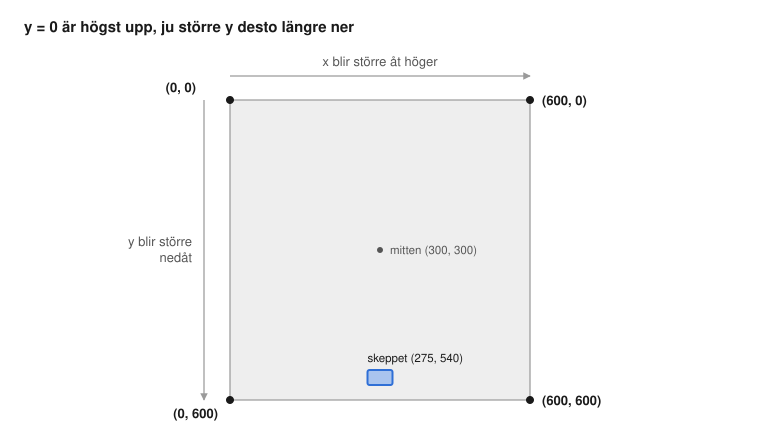

# Rymdskjutaren – bygg ditt första spel i Python

## Så här funkar guiden

Du ska göra ett spel där du styr ett rymdskepp och skjuter ner gröna rymdblobbar som faller från himlen. Om en blobb når marken är det game over.

Du har gjort spel i Scratch, så du kan redan det viktigaste: variabler, loopar, om-block och listor. Det nya är att du **skriver** blocken i stället för att dra dem. Under varje steg finns en tabell som visar vilket Scratch-block koden liknar.

Tre saker är annorlunda än i Scratch:

- **Stavningen måste vara exakt rätt.** `Draw` och `draw` är inte samma sak för Python. Stora och små bokstäver spelar roll.
- **Indrag i stället för blockens "mun".** I Scratch lägger du block inuti ett för alltid- eller om-block. I Python visar du det med fyra mellanslag i början av raden. Tryck på Tab-tangenten så blir det rätt.
- **Fel visas som text.** Blir något fel får du ett rött meddelande längst ner. Läs sista raden, den säger oftast vad som är fel och på vilken rad. Vanligast är ett glömt kolon `:` i slutet av en rad.

Guiden har sju steg. Efter varje steg kör du spelet och ser vad som hänt. Skriv koden själv i stället för att kopiera, då lär du dig mer. Det är helt okej att det blir fel. Det händer alla programmerare hela tiden.

Kör du fast finns färdig kod för varje steg i mappen [`kod`](kod/).

## Steg 0: Gör i ordning datorn

Det här steget är för en vuxen och görs en gång per dator. Vi använder Python 3.13, eftersom spelbiblioteket pygame inte alltid hunnit få stöd för den allra senaste Python-versionen.

### Installera på Mac

Öppna Terminal och skriv:

```
brew install python@3.13
brew install --cask visual-studio-code
```

### Installera på Windows

Öppna PowerShell och skriv:

```
winget install Python.Python.3.13
winget install Microsoft.VisualStudioCode
```

### Sätt upp projektet (båda datorerna)

1. Starta VS Code och installera tillägget **Python** (från Microsoft) under Extensions.
2. Skapa en mapp som heter `rymdspel` och öppna den i VS Code (File → Open Folder).
3. Öppna terminalen i VS Code (Terminal → New Terminal) och skapa en egen Python-miljö för projektet, sedan installera Pygame Zero i den:

Mac:

```
python3.13 -m venv .venv
.venv/bin/python -m pip install pgzero
```

Windows:

```
py -3.13 -m venv .venv
.venv\Scripts\python -m pip install pgzero
```

4. Tryck Cmd+Shift+P (Mac) eller Ctrl+Shift+P (Windows), skriv **Python: Select Interpreter** och välj den som pekar på `.venv`. Då använder play-knappen rätt miljö.
5. Skapa en ny fil i mappen som heter `spel.py`. All kod skriver du i den filen.

Du kör spelet med play-knappen ▶ uppe till höger. Du stänger spelet genom att stänga fönstret.

En egen miljö (`.venv`) behövs på Macen, eftersom Homebrews Python inte tillåter att man installerar paket direkt. På Windows gör vi likadant så att stegen blir samma.

## Steg 1: Ett spelfönster

Skriv det här i `spel.py`:

```python
import pgzrun
from pgzero.builtins import *

WIDTH = 600
HEIGHT = 600


def draw():
    screen.fill("black")


pgzrun.go()
```

**Kör!** Ett svart fönster ska dyka upp. Det är rymden.

**Vad hände?** Du har gjort en scen, som i Scratch, fast helt svart.

| Kod | Liknar i Scratch | Vad den gör |
| --- | --- | --- |
| `import pgzrun` | (finns inte) | Hämtar Pygame Zero, verktygen för att göra spel. Skrivs alltid först. |
| `from pgzero.builtins import *` | (finns inte) | Berättar för VS Code vilka verktyg Pygame Zero har, som `screen` och `Rect`. Då kan VS Code visa förslag medan du skriver. |
| `WIDTH = 600` | scenens storlek | Hur bred skärmen är, i pixlar. En pixel är en liten prick på skärmen. |
| `def draw():` | **för alltid** | Raderna med indrag under körs om och om igen, 60 gånger i sekunden. Här ritar man spelet. |
| `screen.fill("black")` | byt bakgrund | Målar hela skärmen svart. |
| `pgzrun.go()` | när gröna flaggan klickas | Startar spelet. Ska alltid vara sista raden. |

Text inom citattecken, som `"black"`, är vanlig text. Det är som när du skriver i ett säg-block.

**Testa själv:** byt `"black"` mot `"navy"` eller `"purple"`.

Färdig kod: [`kod/steg1.py`](kod/steg1.py)

## Steg 2: Rita skeppet

Skeppet är en rektangel, `Rect`. Lägg till raden med `skepp` under `HEIGHT = 600`:

```python
skepp = Rect(275, 540, 50, 30)
```

Lägg sedan till en rad i `draw()`, så att den ser ut så här:

```python
def draw():
    screen.fill("black")
    screen.draw.filled_rect(skepp, "cyan")
```

**Kör!** En ljusblå rektangel ska synas längst ner.

**Vad hände?** Du har gjort din första sprajt! Än så länge är den bara en ljusblå rektangel.

| Kod | Liknar i Scratch | Vad den gör |
| --- | --- | --- |
| `skepp = Rect(275, 540, 50, 30)` | en ny sprajt + gå till x: y: | Gör en rektangel och döper den till `skepp`. Talen betyder: 275 från vänster, 540 ner från toppen, 50 bred, 30 hög. |
| `screen.draw.filled_rect(skepp, "cyan")` | visa | Ritar skeppet i ljusblått. |

**Se upp!** I Scratch är y = 0 mitt på scenen, och plus är uppåt. Här är y = 0 **högst upp**, och ju större y desto längre **ner**.



Hörnet uppe till vänster är (0, 0). Skeppet står på y = 540, alltså nästan längst ner.

Ordningen spelar roll: det som ritas sist hamnar överst, som lager i Scratch. Därför måste `screen.fill` komma först.

**Testa själv:** ändra talen och se var skeppet hamnar.

Färdig kod: [`kod/steg2.py`](kod/steg2.py)

## Steg 3: Styr skeppet

Lägg till en ny funktion `update()` under `draw()`:

```python
def update():
    if keyboard.left and skepp.left > 0:
        skepp.x = skepp.x - 6
    if keyboard.right and skepp.right < WIDTH:
        skepp.x = skepp.x + 6
```

**Kör!** Nu kan du styra skeppet med piltangenterna vänster och höger.

**Vad hände?** `update()` är också en för alltid-loop. Kom ihåg: i `update()` **flyttar** man saker, i `draw()` **ritar** man dem.

| Kod | Liknar i Scratch | Vad den gör |
| --- | --- | --- |
| `def update():` | för alltid | Körs 60 gånger i sekunden. |
| `if keyboard.left` | om ‹tangent vänsterpil tryckt?› då | Sant medan du håller ner vänsterpilen. |
| `and skepp.left > 0` | ‹ › och ‹ › | Och skeppet har inte redan nått vänsterkanten. |
| `skepp.x = skepp.x - 6` | ändra x med -6 | Flyttar skeppet 6 pixlar åt vänster. |

`>` betyder större än och `<` mindre än, precis som de gröna blocken i Scratch.

**Testa:** ta bort `and skepp.left > 0` och håll in vänsterpilen. Vad händer?

**Testa själv:** byt `6` mot `12`. Blir skeppet snabbare?

Färdig kod: [`kod/steg3.py`](kod/steg3.py)

## Steg 4: Skjut!

Skotten sparas i en **lista**, eftersom det kan finnas många samtidigt. Lägg till under raden med `skepp`:

```python
skott = []
```

Lägg till en ny funktion som körs varje gång man trycker på en tangent:

```python
def on_key_down(key):
    if key == keys.SPACE:
        skott.append(Rect(skepp.centerx - 3, skepp.top - 15, 6, 15))
```

Skotten ska flyga uppåt. Lägg till det här **sist i** `update()`:

```python
    for s in skott[:]:
        s.y = s.y - 10
        if s.bottom < 0:
            skott.remove(s)
```

Och rita dem, **sist i** `draw()`:

```python
    for s in skott:
        screen.draw.filled_rect(s, "yellow")
```

**Kör!** Tryck på mellanslag för att skjuta gula laserskott.

**Vad hände?** Varje gång du trycker på mellanslag läggs ett nytt skott i en lista. Sedan flyttar `update()` alla skotten i listan uppåt.

I Scratch skulle du kanske göra skotten som kloner. I Python sparar vi dem i en **lista** i stället. Listor finns i Scratch också, under Variabler → Skapa en lista. I Python skriver man en lista med hakparenteser, och `[]` betyder en tom lista, alltså en lista utan något i.

| Kod | Liknar i Scratch | Vad den gör |
| --- | --- | --- |
| `skott = []` | skapa listan ‹skott› | En tom lista som ska hålla alla skott. |
| `def on_key_down(key):` | när ‹någon› tangent trycks | Körs varje gång du trycker på en tangent. `key` är vilken tangent det var. |
| `if key == keys.SPACE:` | om ‹tangent mellanslag tryckt?› då | `==` betyder "är lika med?". Ett enda `=` betyder "sätt till". Lätt att blanda ihop! |
| `skott.append(...)` | lägg till ‹ › i ‹skott› (eller skapa klon) | Lägger ett nytt skott sist i listan. Append är engelska och betyder "lägg till". |
| `for s in skott[:]:` | som kloner som var och en kör sitt eget skript | Går igenom skotten ett i taget. Varje varv kallas skottet `s`. |
| `s.y = s.y - 10` | ändra y med 10 | Flyttar skottet uppåt. Här är **minus uppåt**! |
| `skott.remove(s)` | radera ‹ › ur ‹skott› (eller radera denna klon) | Tar bort skottet när det åkt ut ur skärmen. |

De två tecknen `[:]` är ett litet trick som betyder "en kopia av listan". Det behövs när man tar bort saker ur listan samtidigt som man går igenom den. Du behöver inte förstå det helt än, skriv bara likadant.

Kolla indraget: raderna under `for` ska ha fyra mellanslag mer än `for`-raden, precis som block inuti ett annat block i Scratch.

Färdig kod: [`kod/steg4.py`](kod/steg4.py)

## Steg 5: Rymdblobbar

Fienderna ska dyka upp på slumpmässiga ställen. Lägg till den här raden **mellan** `import pgzrun` och `from pgzero.builtins import *` högst upp:

```python
import random
```

Och en lista för fienderna under `skott = []`:

```python
fiender = []
```

Lägg till en funktion som skapar en ny fiende, och en rad som kör den varje sekund. Skriv det precis **ovanför** `pgzrun.go()`:

```python
def ny_fiende():
    fiender.append(Rect(random.randint(0, WIDTH - 40), -40, 40, 40))


clock.schedule_interval(ny_fiende, 1.0)
```

Fienderna ska falla nedåt. Lägg till sist i `update()`:

```python
    for f in fiender:
        f.y = f.y + 3
```

Och rita dem som gröna cirklar, sist i `draw()`:

```python
    for f in fiender:
        screen.draw.filled_circle(f.center, 20, "lime")
```

**Kör!** Gröna blobbar ska börja regna ner. Än så länge går skotten rakt igenom dem.

**Vad hände?** Varje sekund skapas en ny blobb på ett slumpat ställe ovanför skärmen. Alla blobbar faller nedåt.

| Kod | Liknar i Scratch | Vad den gör |
| --- | --- | --- |
| `import random` | (finns inte) | Hämtar slumpverktyget. |
| `def ny_fiende():` | ett eget block (Mina block → Skapa ett block) | Ett stycke kod med ett namn. Det gör ingenting förrän någon kör det. |
| `random.randint(0, WIDTH - 40)` | slumptal mellan 0 och 560 | Väljer var blobben dyker upp. Den är 40 bred, därför "minus 40", så att den inte sticker ut till höger. |
| `fiender.append(...)` | skapa klon | Lägger en ny blobb i listan. |
| `clock.schedule_interval(ny_fiende, 1.0)` | för alltid: ‹ny fiende›, vänta 1 sekunder | Kör `ny_fiende` en gång varje sekund. |
| `f.y = f.y + 3` | ändra y med -3 | Flyttar blobben nedåt. Här är **plus nedåt**. |
| `screen.draw.filled_circle(f.center, 20, "lime")` | visa | Ritar en grön cirkel mitt på blobben. 20 är hur stor den är. |

Blobben startar på y = -40. Minus betyder ovanför skärmen, så den glider in uppifrån.

**Testa själv:** byt `1.0` mot `0.5`. Hur många fiender blir det nu?

Färdig kod: [`kod/steg5.py`](kod/steg5.py)

## Steg 6: Träffar och poäng

Lägg till en variabel för poängen under `fiender = []`:

```python
poang = 0
```

(Vi skriver `poang` utan ä, eftersom variabelnamn helst bara ska ha a–z.)

Lägg till den här raden **först** i `update()`, direkt under `def update():`

```python
    global poang
```

Lägg sedan till det här **sist** i `update()`:

```python
    for f in fiender[:]:
        for s in skott[:]:
            if f.colliderect(s):
                fiender.remove(f)
                skott.remove(s)
                poang = poang + 1
                break
```

Visa poängen högst upp till vänster, sist i `draw()`:

```python
    screen.draw.text("Poäng: " + str(poang), (10, 10), fontsize=40)
```

**Kör!** Nu försvinner blobbarna när du träffar dem, och poängen räknas upp.

**Vad hände?** Spelet kollar hela tiden om något skott rör vid någon blobb. Om det gör det försvinner båda, och du får en poäng.

| Kod | Liknar i Scratch | Vad den gör |
| --- | --- | --- |
| `poang = 0` | skapa variabeln ‹poäng›, sätt till 0 | Poängen börjar på 0. |
| `global poang` | (finns inte) | Berättar att `update()` får ändra `poang`. Utan den kraschar spelet vid första träffen. |
| `for f in fiender[:]:` och `for s in skott[:]:` | (finns inte) | För varje blobb kollar vi alla skott. En loop inuti en loop. |
| `if f.colliderect(s):` | om ‹rör vid ‹skott›?› då | Sant om blobben och skottet nuddar varandra. |
| `fiender.remove(f)` | radera denna klon | Tar bort blobben. |
| `poang = poang + 1` | ändra ‹poäng› med 1 | Ger en poäng. |
| `break` | (finns inte) | Sluta kolla fler skott för den här blobben, den är ju redan borta. |
| `screen.draw.text("Poäng: " + str(poang), ...)` | visa variabeln ‹poäng› | Skriver poängen uppe till vänster. |

`str(poang)` gör om talet till text, så att det kan sättas ihop med "Poäng: ". Det fungerar som sätt ihop-blocket i Scratch.

**Kraschar det när du träffar?** Står det `UnboundLocalError` i felmeddelandet? Då saknas `global poang`. Den ska stå på raden direkt under `def update():`, med fyra mellanslag först.

Färdig kod: [`kod/steg6.py`](kod/steg6.py)

## Steg 7: Game over och starta om

Spelet ska ta slut om en blobb når marken eller krockar med skeppet. Det här steget ändrar på flera ställen, så ta det lugnt.

**a)** Lägg till under `poang = 0`:

```python
game_over = False
```

**b)** Ändra de två första raderna i `update()` så att de ser ut så här:

```python
def update():
    global poang, game_over
    if game_over:
        return
```

`return` betyder "sluta här". När det är game over står allt still.

**c)** Byt ut loopen som flyttar fienderna mot den här:

```python
    for f in fiender[:]:
        f.y = f.y + 3
        if f.top > HEIGHT or skepp.colliderect(f):
            game_over = True
```

**d)** Byt ut hela `on_key_down` mot den här versionen, som också kan starta om spelet med R:

```python
def on_key_down(key):
    global poang, game_over
    if key == keys.SPACE and not game_over:
        skott.append(Rect(skepp.centerx - 3, skepp.top - 15, 6, 15))
    if key == keys.R and game_over:
        skott.clear()
        fiender.clear()
        poang = 0
        skepp.x = 275
        game_over = False
```

**e)** Inga nya fiender när spelet är slut. Ändra `ny_fiende`:

```python
def ny_fiende():
    if not game_over:
        fiender.append(Rect(random.randint(0, WIDTH - 40), -40, 40, 40))
```

**f)** Visa texten, sist i `draw()`:

```python
    if game_over:
        screen.draw.text("GAME OVER", center=(300, 280), fontsize=80, color="red")
        screen.draw.text("Tryck R för att börja om", center=(300, 350), fontsize=40)
```

**Vad hände?** `game_over` är en variabel som bara kan vara `True` (sant) eller `False` (falskt). Den är som en strömbrytare. När en blobb når marken slås den på, och då står allt still. Trycker du R slås den av, och spelet börjar om.

| Kod | Liknar i Scratch | Vad den gör |
| --- | --- | --- |
| `game_over = False` | sätt ‹game over› till 0 | I början är spelet inte slut. |
| `if game_over: return` | stoppa detta skript | Om spelet är slut görs inget mer i `update()`, så inget rör sig. |
| `f.top > HEIGHT` | om ‹y < -180› | Blobben har ramlat ner under skärmen. |
| `or` | ‹ › eller ‹ › | Det räcker att en av sakerna är sann. |
| `not game_over` | inte ‹ › | Sant när spelet **inte** är slut. |
| `skott.clear()` | radera alla från ‹skott› | Tömmer listan. |
| `center=(300, 280)` | gå till x: y: | Placerar texten mitt på skärmen. |

**Kör!** Nu är det ett riktigt spel. Hur många poäng klarar du?

Om något inte funkar: jämför med den färdiga koden, [`kod/steg7.py`](kod/steg7.py). Rader som börjar med `#` är kommentarer. Python hoppar över dem, de är bara anteckningar till dig, precis som kommentarer i Scratch.

## Bonus: egna bilder och fler idéer

**Rita ditt eget skepp.** Gå till piskelapp.com och rita ett skepp i pixelstil, ungefär 50 × 30 pixlar. Exportera som PNG och spara filen som `skepp.png` i en ny mapp `images` inuti `rymdspel`. Ändra sedan i koden:

```python
skepp = Actor("skepp", (300, 555))
```

I `draw()`, byt raden som ritar rektangeln mot:

```python
    skepp.draw()
```

En `Actor` är som en `Rect` med en bild, så resten av koden fungerar som förut. Samma sak går att göra med fienderna när du fått kläm på det.

**Fler saker att bygga:**

- Fienderna faller snabbare ju fler poäng du har. Tips: byt `3` mot `3 + poang / 10`.
- Tre liv i stället för game over direkt.
- Ljud när du skjuter: lägg en ljudfil `pang.wav` i en mapp `sounds` och skriv `sounds.pang.play()`.
- Ett rekord som visas på game over-skärmen.
- Fiender som åker i sicksack i stället för rakt ner.
